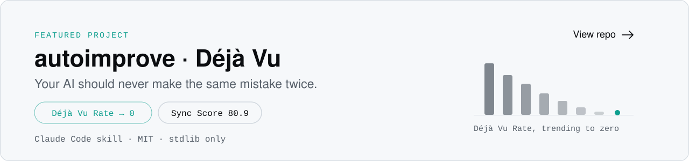
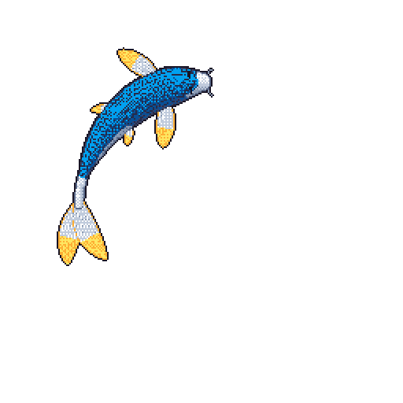

<picture>
  <source media="(prefers-color-scheme: dark)" srcset="assets/hero-dark.svg">
  
</picture>

### What I do

I build internal web tools end to end: the data model, the workflows, and the screens people use every day. 
The stack is TypeScript and React on the front, Supabase and Postgres underneath, shipped on Vercel. 
Claude Code is in the loop every day, and I spend real time teaching it to get better at working with me.

 

<a href="https://github.com/kauxhi/autoimprove-deja-vu">
  <picture>
    <source media="(prefers-color-scheme: dark)" srcset="assets/project-dark.svg">
    
  </picture>
</a>

  

  <picture>
    <source media="(prefers-color-scheme: dark)" srcset="assets/pond-dark.svg">
    
  </picture>

  

Redrawn every night from my GitHub activity, by <a href="https://github.com/kauxhi/git-koi">git-koi</a>.

 

TypeScript · React · Supabase · Postgres · Vercel · Claude Code

<a href="https://www.linkedin.com/in/gandhi-kaushik">LinkedIn</a>

