<picture>
  <source media="(prefers-color-scheme: dark)" srcset="assets/hero-dark.svg">
  
</picture>

### About me

I'm an AI engineer in Bengaluru who ships production AI end to end, mostly solo, with Claude Code and agent harnesses in the loop every day.

- **Now:** founding AI engineer at a clinical research company, building its internal tools on TypeScript, React, Supabase, Postgres and Vercel.
- **Before:** a multilingual phone voice agent in five Indian languages, and production LLM pipelines.
- **Focus:** LLMs, RAG and agentic AI, voice AI, production ML.
- **Background:** M.Sc. in AI & ML (Christ University, 2026), a paper at IC-AIDA 2026, 1st place in a national datathon.
- **Side projects:** TechConnect, CivicBot (a RAG assistant), and autoimprove, below.
- **Writing:** neural audio codecs, voice AI and agentic RAG, on [Medium](https://medium.com/@kauxhik77).

More on my site: **[kaushik-builds.xyz](https://www.kaushik-builds.xyz)**

 

<a href="https://github.com/kauxhi/autoimprove-deja-vu">
  <picture>
    <source media="(prefers-color-scheme: dark)" srcset="assets/project-dark.svg">
    
  </picture>
</a>

  

  <picture>
    <source media="(prefers-color-scheme: dark)" srcset="assets/pond-dark.svg">
    
  </picture>

  

Redrawn every night from my GitHub activity, by <a href="https://github.com/kauxhi/git-koi">git-koi</a>.

 

TypeScript · React · Supabase · Postgres · Vercel · Claude Code

<a href="https://www.kaushik-builds.xyz">Portfolio</a> · <a href="https://www.linkedin.com/in/gandhi-kaushik">LinkedIn</a> · <a href="https://medium.com/@kauxhik77">Medium</a>

